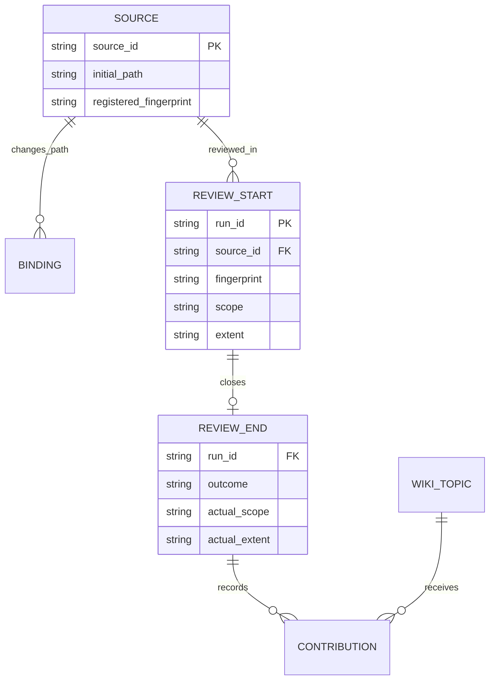
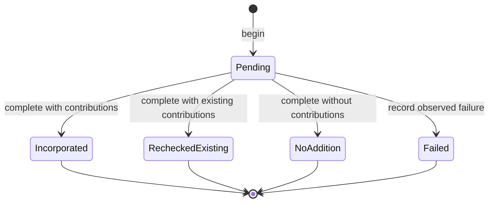

# Architecture

## Vault pointer index

The Markdown vault remains the source of truth. `scripts/index_vault.py` reads Markdown, VTT, and SRT files under `raw/` and Markdown files under `wiki/`, then stores one lightweight pointer per source in MemPalace. The pointer contains a relative path and a short excerpt, not the complete source.

The indexer scans and reads all expected source files before writing anything. An incomplete scan, unreadable source, or source-directory symlink stops the run before collection mutation. After a successful scan, it upserts changed pointers and optionally prunes missing pointers belonging to that vault and indexer.

Each indexed pointer records:

- `vault_id`: SHA-256 prefix of the normalized vault path
- `source_file`: vault-relative source path
- `content_hash`: SHA-256 of the original file bytes
- `index_version`: parser/index format version, to refresh pointers after parser changes
- `wing`, `room`, and `added_by`: MemPalace routing and ownership metadata

The pointer ID is derived from `vault_id` and `source_file`; the content hash is metadata, so content changes update the same pointer. A moved vault has a different identity. Legacy pointers without `vault_id` are left untouched rather than guessed to belong to a particular vault.

```mermaid
sequenceDiagram
  participant User
  participant Script as index_vault.py
  participant Vault as Markdown vault
  participant Palace as MemPalace
  User->>Script: Run --sync with vault and palace paths
  Script->>Vault: Validate raw/ and wiki/, scan supported sources
  Vault-->>Script: Source bytes, relative paths, excerpts, hashes
  alt Scan incomplete
    Script-->>User: Report errors; perform no pointer writes or pruning
  else Scan complete
    Script->>Palace: Read indexer-owned pointers for this vault
    Palace-->>Script: Existing pointer metadata
    Script->>Palace: Upsert changed pointers
    opt Pruning enabled and within safety limit
      Script->>Palace: Delete missing pointers for this vault only
    end
    Script-->>User: Report added, updated, skipped, and pruned counts
  end
```

## Local synthesis review journal

`scripts/synthesis_tracker.py` is independent of MemPalace. It inventories
`raw/`, resolves citations from `wiki/`, and writes only local Markdown records
and a generated report in `tracking/` (configurable outside source/kit folders).
It never changes source or wiki bodies. The persisted/CLI contract is
[synthesis_tracking.md](synthesis_tracking.md); the decision is
[ADR 0001](adr/0001-local-synthesis-review-journal.md).

Source UUIDs identify captured files, independently of current path. Existing
citations are imported as references with unknown historical review. Review
starts/completions/failures and explicit path bindings are append-only records;
positive contiguous sequences provide order independently of wall clocks. A
source can have many review scopes/topic contributions. Closed reviews cannot
be rewritten; identical retries return historical records rather than reasserting
current validity. Hashes are not archived source versions.



These are logical entities embedded in Markdown/JSON records, not database
tables. Contributions describe declared use and structural citations; the agent
must still compare each claim with its source.



A missing ending stays pending/interrupted. A new review is a new ID, not a
terminal state's reopening. Source/citation checks precede completion and final
byte rechecks reject observable changes, but editors/sync may change files after
that check. A short local `.lock` coordinates journal operations on one writer
machine only. Corrupt/conflict/gapped records stop writes; backups are needed to
recover and to detect deletion of final records. Application append-only is not
tamper resistance or a distributed transaction.

The generated report is excluded from source inventory and cannot cite sources
into coverage merely by listing them. Tracking is ignored by Git by default and
outside the indexer's `raw/`/`wiki/` scope, so journal metadata does not introduce
new indexed excerpts. Existing source indexing/privacy behavior is unchanged.
