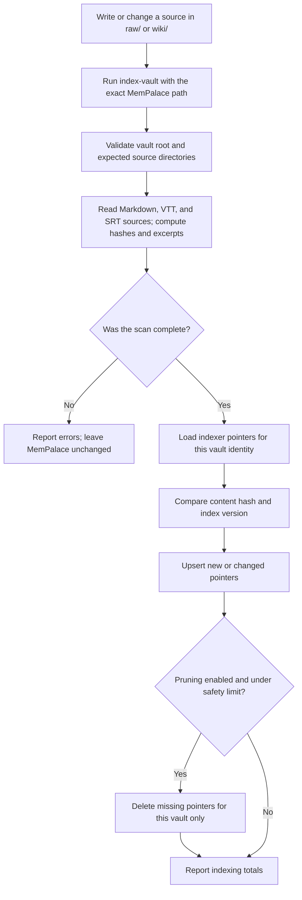
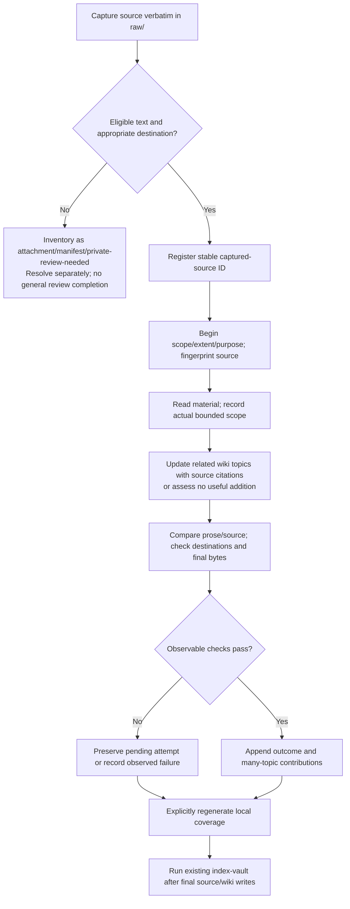

# System flow

After any write under `raw/` or `wiki/`, the user runs `index-vault`. The script reads the full source set before touching MemPalace. A scan failure stops the run without changing pointers. A successful scan refreshes changed pointers and prunes missing pointers only within the same vault identity.

## Compilation with declared review history

No file watcher starts these steps. Reports distinguish referenced/unknown
history from partial/all-captured reviews, no-addition, rechecked contributions
and pending/failed attempts. Tracking-only files are local and outside pointer
indexing. Compilation privacy classification does not change whether the
existing indexer reads diary excerpts under `raw/`.
